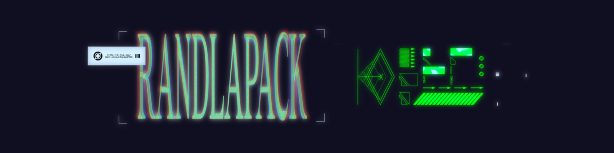

<p align="center">
  
</p>

# RandLAPACK

RandLAPACK is a C++ library of high-performance randomized algorithms for
linear algebra problems such as least squares, (kernel) ridge regression,
low-rank approximation, and matrix factorizations. Its API is not yet stable;
we are actively working on changing that.

RandLAPACK builds on [RandBLAS](https://github.com/BallisticLA/RandBLAS), a
header-only C++ library for sketching in randomized linear algebra
(sketching compresses a matrix by multiplying it with a random one). RandBLAS
comes with RandLAPACK as a pinned git submodule (another git repository
included at one fixed commit), so you do not install it separately. For
MATLAB, [randlapack-bindings](https://github.com/BallisticLA/randlapack-bindings)
provides bindings: currently a proof of concept for `BQRRP` (blocked QR
with randomized column pivoting), in single and double precision, with
Python planned.

Questions, or want to get involved in development? Join
[**our Discord server**](https://discord.gg/R4qj8Er9YW).

## Install

### Linux and macOS

First install a C++20 compiler (GCC 13 or newer on Linux), CMake 3.24 or
later, Git, a BLAS/LAPACK library (the standard low-level linear algebra
routines) and GoogleTest. These are the packages CI installs:

```shell
# Ubuntu 24.04
sudo apt-get update && sudo apt-get install git-core gcc g++ gfortran cmake libgtest-dev libopenblas-openmp-dev

# macOS: the built-in Accelerate provides BLAS/LAPACK; libomp adds multithreading
xcode-select --install
brew install cmake googletest libomp
```

Without GoogleTest, no tests are built. To use Intel oneMKL instead of
OpenBLAS, load oneAPI's environment (`source <oneapi>/setvars.sh`) first. On
a machine with an NVIDIA GPU, read the GPU note in
[INSTALL_SCRIPT.md, section 2](docs/INSTALL_SCRIPT.md#2-requirements). Then
build and install:

```shell
git clone --recursive https://github.com/BallisticLA/RandLAPACK.git
cd RandLAPACK
bash install.sh
```

Check the install by running the test suite. The installer's final summary
prints this build directory; it differs if you set `RANDNLA_PROJECT_DIR`.

```shell
OMP_NUM_THREADS=1 ctest --test-dir ../RandNLA-project/build/RandLAPACK-build -j 4
```

The installer builds RandLAPACK, its dependencies, the extras and benchmark
projects, and the test suite. The dependencies are BLAS++ and LAPACK++ (C++
wrappers for BLAS and LAPACK, built from the BallisticLA forks), Random123,
and RandBLAS, from its submodule. Run `bash install.sh --help` for the
options: GPU support, parallelism, reusing preinstalled dependencies, and
more.

### Native Windows

From an "x64 Native Tools Command Prompt for VS 2022"
([INSTALL_WINDOWS.md](docs/INSTALL_WINDOWS.md) explains which prompt to open,
and why):

```bat
mkdir C:\src & cd /d C:\src
git clone --recursive https://github.com/BallisticLA/RandLAPACK.git
cd RandLAPACK
powershell -ExecutionPolicy Bypass -File .\installers\install.ps1
```

This builds the dependencies and RandLAPACK and runs the test suite; it does
not build the extras or benchmark projects.

### From your own project, and by hand

- To use RandLAPACK from your own CMake project, with a minimal example
  program, see [docs/USING.md](docs/USING.md).
- To build every piece by hand instead, see
  [docs/INSTALL_MANUAL.md](docs/INSTALL_MANUAL.md). This is an advanced,
  riskier option: the installers keep the dependencies consistent for you.

[docs/DEPENDENCIES.md](docs/DEPENDENCIES.md#tested-setups) lists the hardware
and software setups where RandLAPACK has been tested.

## What's in the library

The user-facing algorithms, called "drivers"
([docs/ARCHITECTURE.md](docs/ARCHITECTURE.md) explains how the library is
organized):

| Driver | Problem it solves | Reference |
|--------|-------------------|-----------|
| `BQRRP` | Blocked QR with randomized column pivoting, any aspect ratio | [arXiv:2507.00976](https://arxiv.org/abs/2507.00976) |
| `CQRRPT` | Sketch-based QR with column pivoting for tall matrices | [arXiv:2311.08316](https://arxiv.org/abs/2311.08316) |
| `CQRRT` | Unpivoted QR of tall, full-rank matrices by sketch-preconditioned Cholesky QR; `CQRRT_linops` is its Q-less variant for linear operators | [arXiv:2111.11148](https://arxiv.org/abs/2111.11148) |
| `RSVD` | Randomized low-rank SVD via the QB decomposition, of a dense matrix or any linear operator (sparse or implicit) | [arXiv:0909.4061](https://arxiv.org/abs/0909.4061) |
| `REVD2` | Randomized low-rank eigendecomposition of symmetric positive semidefinite matrices | [arXiv:2110.02820](https://arxiv.org/abs/2110.02820) |
| `ABRIK` | Block-Krylov iterative SVD for many accurate singular triplets | [arXiv:2306.12418](https://arxiv.org/abs/2306.12418) |
| `hqrrp` | Householder QR with randomized pivoting | [arXiv:1512.02671](https://arxiv.org/abs/1512.02671) |
| `krill_full_rpchol` | Kernel ridge regression by conjugate gradients, preconditioned with randomly pivoted Cholesky | [arXiv:2304.12465](https://arxiv.org/abs/2304.12465) |

- BQRRP and CQRRPT also have CUDA (GPU) implementations, `BQRRP_GPU` and
  `CQRRPT_GPU`.
- `CholQR_linops` and `sCholQR3_linops` are deterministic Cholesky QR
  baselines for linear operators, for comparison with `CQRRT_linops`.
- The drivers are assembled from smaller randomized building blocks that you
  can also use on their own: rangefinders, QB, block Krylov, row sketching,
  orthogonalization and stabilization routines, and randomly pivoted Cholesky
  (`rp_cholesky`).
- The RandNLA monograph ([arXiv:2302.11474](https://arxiv.org/abs/2302.11474))
  is the best background reference for these algorithm families.

## Related libraries

Before RandLAPACK, we implemented several high-level RandNLA algorithms in
MATLAB ([MARLA](https://github.com/BallisticLA/marla)) and Python
([PARLA](https://github.com/BallisticLA/parla)). PARLA treats *algorithms as
objects*: you instantiate an algorithm with its tuning parameters and
subroutines before using it. RandLAPACK currently emphasizes the same
approach.

## Where to go from here

| You want to... | Read |
|----------------|------|
| Install with one command on Linux or macOS | [docs/INSTALL_SCRIPT.md](docs/INSTALL_SCRIPT.md) |
| Install on native Windows (MSVC) | [docs/INSTALL_WINDOWS.md](docs/INSTALL_WINDOWS.md) |
| Use RandLAPACK from your own CMake project (with an example program) | [docs/USING.md](docs/USING.md) |
| Install by hand (advanced, riskier) | [docs/INSTALL_MANUAL.md](docs/INSTALL_MANUAL.md) |
| See the tested setups, dependency versions and CUDA requirements | [docs/DEPENDENCIES.md](docs/DEPENDENCIES.md) |
| Understand how the library is organized | [docs/ARCHITECTURE.md](docs/ARCHITECTURE.md) |
| Contribute code | [CONTRIBUTING.md](CONTRIBUTING.md) |
| See what CI checks, and why | [docs/CI.md](docs/CI.md) |
| Run or add performance benchmarks | [benchmark/README.md](benchmark/README.md) |
| Use the Eigen/Matrix-Market integrations | [extras/README.md](extras/README.md) |
