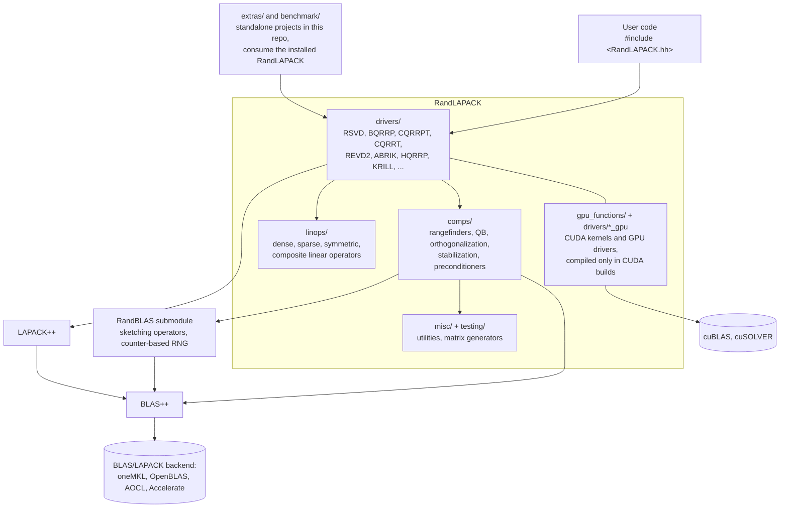

# How RandLAPACK is organized

This is the map for reading or extending the library. For installation see
the [README](../README.md#install); for the contribution workflow see
[CONTRIBUTING.md](../CONTRIBUTING.md).

## In short

- RandLAPACK is a header-only C++20 template library. User code includes a
  single umbrella header, `RandLAPACK.hh`.
- User code calls **drivers**: complete randomized algorithms (randomized
  SVD, QR with column pivoting, kernel ridge regression solvers, ...).
- Drivers are assembled from **computational routines** (rangefinders, QB,
  block Krylov, orthogonalization, stabilization) and from the sketching
  primitives of **RandBLAS**, which ships inside this repository as a pinned
  git submodule.
- Dense linear algebra goes through the **BLAS++** and **LAPACK++** wrapper
  libraries, so any BLAS/LAPACK backend (oneMKL, OpenBLAS, AOCL,
  Accelerate) can sit underneath. Both wrappers are built from the
  BallisticLA forks at the
  commits pinned in
  [`installers/dependency-pins.env`](../installers/dependency-pins.env)
  ([DEPENDENCIES.md](DEPENDENCIES.md#why-blas-and-lapack-come-from-forks)
  explains why).



## Directory map

```
RandLAPACK/                     (repository root)
|-- RandLAPACK.hh               single umbrella header: the public include
|-- RandLAPACK/                 all library code (header-only templates)
|   |-- rl_blaspp.hh            BLAS++ shim
|   |-- rl_lapackpp.hh          LAPACK++ shim
|   |-- rl_exceptions.hh        RandLAPACK::Error + randlapack_require
|   |-- rl_config.hh.in         configured into rl_config.hh at build time
|   |-- drivers/                user-facing algorithms (rl_rsvd.hh,
|   |                           rl_bqrrp.hh + rl_bqrrp_gpu.hh, rl_cqrrpt.hh
|   |                           + rl_cqrrpt_gpu.hh, rl_cqrrt.hh,
|   |                           rl_cqrrt_linops.hh, rl_cholqr_linops.hh,
|   |                           rl_scholqr3_linops.hh, rl_blendenpik.hh,
|   |                           rl_revd2.hh, rl_abrik.hh, rl_hqrrp.hh,
|   |                           rl_krill.hh, ...)
|   |-- comps/                  computational building blocks (rl_rf.hh
|   |                           rangefinders, rl_rs.hh row sketching,
|   |                           rl_qb.hh, rl_bk.hh block Krylov, rl_orth.hh,
|   |                           rl_syps.hh/rl_syrf.hh, rl_rpchol.hh,
|   |                           rl_preconditioners.hh, rl_determiter.hh,
|   |                           rl_lsqr.hh, rl_cholqr.hh Q-less Cholesky QR)
|   |-- linops/                 linear-operator abstractions (concepts;
|   |                           dense, sparse, symmetric, composite,
|   |                           power, transposed, scaled-identity and
|   |                           stacked operators) used by matrix-free drivers
|   |-- gpu_functions/          CUDA kernels and cuSOLVER dispatch helpers
|   |                           (compiled only by a CUDA compiler)
|   |-- misc/                   rl_util.hh, rl_pdkernels.hh, rl_thread_caps.hh
|   `-- testing/                matrix generators, matrix file readers and
|                               test utilities that ship with the library
|                               (rl_gen.hh, rl_matrix_io.hh, ...)
|-- RandBLAS/                   git submodule, pinned to an exact commit
|-- test/                       GoogleTest suite, mirrors the source layout
|-- benchmark/                  standalone CMake project (see its README)
|-- extras/                     standalone CMake project (Eigen +
|                               fast_matrix_market integrations)
|-- CMake/                      build options, version, config templates,
|                               Windows runtime-DLL staging
|-- installers/                 install.sh (Linux, macOS), install.ps1
|                               (native Windows), dependency-pins.env
|-- install.sh                  wrapper, so `bash install.sh` works from
|                               the root
|-- docs/                       this file, the install guides, CI notes
|-- devnotes/                   catalog of the C++ idioms in use
`-- .github/                    CI workflows and their helper scripts
```

## The three-tier build

The repository builds as three CMake projects, not one:

1. **Core library** (root `CMakeLists.txt`). It installs the headers and
   CMake config, and builds the test suite when `RandLAPACK_BUILD_TESTS=ON`
   (the default) and GoogleTest is found. RandBLAS is built from the
   submodule (or, for package maintainers only, used as an installed package
   behind the `RandLAPACK_EXTERNAL_RandBLAS` commit gate; see
   [DEPENDENCIES.md](DEPENDENCIES.md#randblas-is-a-pinned-submodule)).
2. **benchmark/** measures RandLAPACK's performance (the harnesses behind
   the papers). Its shared helpers, `benchmark/rl_bench_utils.hh`, belong
   to it and do not install with the library. Some benchmarks borrow
   headers from `extras/`.
3. **extras/** is a holding area for functionality that currently needs
   third-party libraries (Eigen, fast_matrix_market) that core RandLAPACK
   will not depend on; [extras/README.md](../extras/README.md) gives the
   graduation policy.

`benchmark/` and `extras/` are separate downstream projects. They use the
*installed* RandLAPACK through `find_package`, exactly as user code does,
which keeps them honest as consumers and keeps their extra dependencies out
of the library build.

On Linux and macOS, `installers/install.sh` builds all three in order, plus
the dependencies; see [INSTALL_SCRIPT.md](INSTALL_SCRIPT.md). On native
Windows, `installers/install.ps1` builds the dependencies and the core
library and runs its tests, but not extras or benchmarks; see
[INSTALL_WINDOWS.md](INSTALL_WINDOWS.md).

## Conventions

Review enforces the layout, buffer, error and randomness rules for new code.

- **Layout and types.** Column-major storage; `int64_t` for all dimensions,
  leading dimensions and indices; the element type is a template parameter
  `T` (float/double).
- **Drivers are objects.** Most are constructed with their tuning
  parameters, then run with `call(...)`. A few, such as `hqrrp` and
  `krill_full_rpchol`, are free functions.
- **Buffers.** Outputs and workspaces are raw buffers. New code uses no
  `std::vector` for anything sized by the problem, and passes an output the
  routine allocates or grows as a pointer reference (`T*&`), as `RSVD::call`
  does with its factors. Some older routines, such as `REVD2`, still use
  `std::vector`.
- **Errors.** New code throws rather than asserts: `randlapack_require(...)`
  throws `RandLAPACK::Error`, with a message that states what was violated
  and the offending values.
- **Randomness** comes only from RandBLAS's counter-based (Philox)
  generators, through `RandBLAS::RNGState`, never from `std::rand` or
  `std::mt19937`. The random numbers a routine draws are therefore
  reproducible from a seed, independent of threading. Its results can still
  differ in the last bits from run to run, because a multithreaded BLAS may
  sum in a different order.
- **GPU code** lives in `gpu_functions/` and `drivers/*_gpu.hh`. CUDA support
  is opt-in (`-DRequireCUDA=ON`) and not available on native Windows.
  - The umbrella header includes the GPU layer only when a CUDA compiler is
    processing the file (`#if defined(__CUDACC__)`). `.cu` translation units
    therefore get the GPU drivers, and host-only `.cc` files build without
    the CUDA toolkit on the include path.
  - `gpu_functions/rl_cuda_kernels.cuh` derives `USE_CUDA` from
    `__CUDACC__`, so `.cu` files do not define it themselves.
  - Inside `rl_cuda_kernels.cuh`, kernels and their launches go inside the
    `#ifdef USE_CUDA` regions and host-callable wrappers outside, so the
    header still compiles without nvcc when the CUDA headers are available
    (the wrappers then throw when called).

[devnotes/idioms.md](../devnotes/idioms.md) catalogs the C++ idioms we use
deliberately (templated callables for duck typing, C++20 concepts,
type-erased ownership, zero-copy transpose views), with rationale and
examples.
