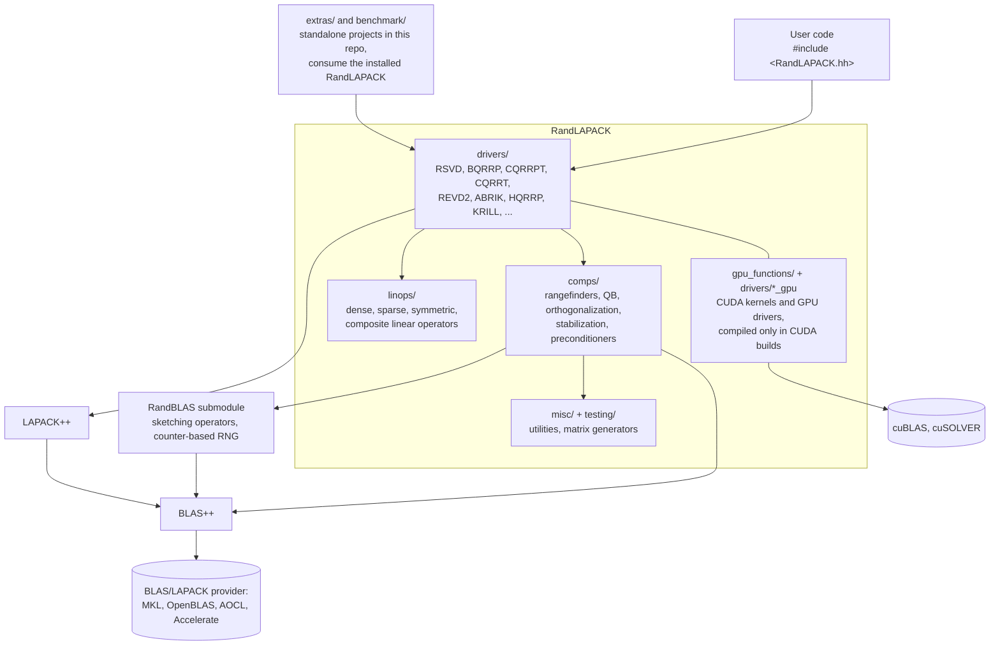

# How RandLAPACK is organized

This is the map for reading or extending the library. For installation see
[INSTALL.md](INSTALL.md); for the contribution workflow see
[CONTRIBUTING.md](../CONTRIBUTING.md).

## The one-paragraph version

RandLAPACK is a header-only C++20 template library. User code includes a
single umbrella header, `RandLAPACK.hh`, and calls **drivers**: complete
randomized algorithms (randomized SVD, QR with column pivoting, kernel ridge
regression solvers, ...). Drivers are assembled from **computational
routines** (rangefinders, QB, block Krylov, orthogonalization,
stabilization) and from the sketching primitives of **RandBLAS**, which ships
inside this repository as a pinned git submodule. Dense linear algebra goes
through the **BLAS++** and **LAPACK++** wrapper libraries, so any BLAS/LAPACK
provider (MKL, OpenBLAS, AOCL, Accelerate) can sit underneath; both wrappers
are built from the BallisticLA forks at the commits pinned in
[`installers/dependency-pins.env`](../installers/dependency-pins.env).
Matrices are column-major, dimensions are `int64_t`, and every public entry
point is templated on the element type.



## Directory map

```
RandLAPACK/                     (repository root)
|-- RandLAPACK.hh               single umbrella header: the public include
|-- RandLAPACK/                 all library code (header-only templates)
|   |-- rl_blaspp.hh            BLAS++ shim
|   |-- rl_lapackpp.hh          LAPACK++ shim
|   |-- rl_exceptions.hh        RandLAPACK::Error + randlapack_require
|   |-- rl_config.hh.in         configured into rl_config.hh at build time
|   |-- drivers/                user-facing algorithms (rl_rsvd.hh,
|   |                           rl_bqrrp.hh + rl_bqrrp_gpu.hh, rl_cqrrpt.hh
|   |                           + rl_cqrrpt_gpu.hh, rl_cqrrt.hh,
|   |                           rl_cqrrt_linops.hh, rl_revd2.hh, rl_abrik.hh,
|   |                           rl_hqrrp.hh, rl_krill.hh, ...)
|   |-- comps/                  computational building blocks (rl_rf.hh
|   |                           rangefinders, rl_rs.hh row sketching,
|   |                           rl_qb.hh, rl_bk.hh block Krylov, rl_orth.hh,
|   |                           rl_syps.hh/rl_syrf.hh, rl_rpchol.hh,
|   |                           rl_preconditioners.hh, rl_determiter.hh)
|   |-- linops/                 linear-operator abstractions (concepts;
|   |                           dense, sparse, symmetric and composite
|   |                           operators) used by matrix-free drivers
|   |-- gpu_functions/          CUDA kernels and cuSOLVER dispatch helpers
|   |                           (compiled only by a CUDA compiler)
|   |-- misc/                   rl_util.hh, rl_pdkernels.hh
|   `-- testing/                matrix generators, matrix file readers and
|                               test utilities that ship with the library
|                               (rl_gen.hh, rl_matrix_io.hh, ...)
|-- RandBLAS/                   git submodule, pinned to an exact commit
|-- test/                       GoogleTest suite, mirrors the source layout
|-- benchmark/                  standalone CMake project (see its README)
|-- extras/                     standalone CMake project (Eigen +
|                               fast_matrix_market integrations)
|-- CMake/                      build options, version, config templates,
|                               Windows runtime-DLL staging
|-- installers/                 install.sh (Linux, macOS), install.ps1
|                               (native Windows), dependency-pins.env
|-- install.sh                  wrapper, so `bash install.sh` works from
|                               the root
|-- docs/                       this file, the install guides, CI notes
|-- devnotes/                   catalog of the C++ idioms in use
`-- .github/                    CI workflows and their helper scripts
```

## The three-tier build

The repository builds as three CMake projects, not one:

1. **Core library** (root `CMakeLists.txt`): installs the headers and CMake
   config, and builds the test suite when `RandLAPACK_BUILD_TESTS=ON` (the
   default) and GoogleTest is found.
   RandBLAS is built from the submodule (or, for package maintainers only,
   consumed as an installed package behind the
   `RandLAPACK_EXTERNAL_RandBLAS` commit gate; see
   [INSTALL.md](INSTALL.md#randblas-is-a-pinned-submodule)).
2. **extras/** and 3. **benchmark/**: separate downstream projects that
   consume the *installed* RandLAPACK via `find_package`, exactly like user
   code does. This keeps them honest as consumers and keeps their extra
   dependencies out of the library build. Their purposes differ: `benchmark/`
   measures RandLAPACK's performance (the harnesses behind the papers),
   while `extras/` is a holding area for functionality that currently needs
   third-party libraries (Eigen, fast_matrix_market) that core RandLAPACK
   will not depend on; see [extras/README.md](../extras/README.md) for the
   graduation policy. (Some benchmarks do borrow headers from `extras/`.)

On Linux and macOS, `installers/install.sh` drives all three in order, plus
the dependency builds; see [INSTALL_SCRIPT.md](INSTALL_SCRIPT.md). On native
Windows, `installers/install.ps1` builds the dependencies and the core
library and runs its tests, but not extras or benchmarks; see
[INSTALL_WINDOWS.md](INSTALL_WINDOWS.md).

## Conventions

- Column-major storage; `int64_t` for all dimensions, leading dimensions,
  and indices; element type is a template parameter `T` (float/double).
- Most drivers are objects: construct with tuning parameters, then
  `call(...)`. A few, such as `hqrrp` and `krill_full_rpchol`, are free
  functions.
- New code takes outputs and workspaces as raw buffers (`T*&` for an output
  the routine allocates, as `RSVD::call` does); some older routines, such as
  `REVD2`, still use `std::vector`.
- Errors: `randlapack_require(...)` throws `RandLAPACK::Error` with a
  descriptive message; new code throws rather than asserts.
- Randomness comes exclusively from RandBLAS's counter-based generators
  (`RandBLAS::RNGState`), which makes every randomized routine reproducible
  from a seed, independent of threading.
- GPU code lives in `gpu_functions/` and `drivers/*_gpu.hh`. The umbrella
  header includes it only when a CUDA compiler is processing the file
  (`#if defined(__CUDACC__)`), so `.cu` translation units get the GPU drivers
  and host-only `.cc` files build without the CUDA toolkit on the include
  path. CUDA support is opt-in (`-DRequireCUDA=ON`) and not available on
  native Windows.

See [devnotes/idioms.md](../devnotes/idioms.md) for a catalog of the C++
idioms (templated callables for duck typing, C++20 concepts, type-erased
ownership, zero-copy transpose views) with rationale and examples.
